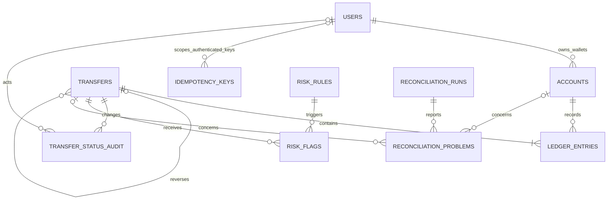

# Database schema design

This document records the schema decisions for the Grade Wallet Ledger against the authoritative `Brief.pdf`. Money is stored as whole paise in `BIGINT`. Table names are plural snake_case and column names are singular.

## Noun review

| Noun or concept in the brief | Table? | Reason and representation |
| --- | --- | --- |
| User | `users` | A person has identity and contact/KYC attributes and owns wallets. |
| Wallet | `accounts` | A wallet has its own currency, name, balance and owner. It is an account, so it shares the accounts table with system accounts. |
| System account | `accounts` | Cash-in, cash-out and fee revenue are accounts with no user owner. `account_type` distinguishes wallet from system account; `account_name` distinguishes a system account's purpose. |
| Transfer | `transfers` | A transfer is the business event: type, status, amount, creation time, and optional reference to the original transfer when it reverses one. |
| Ledger entry / debit / credit / ledger line | `ledger_entries` | These are individual accounting lines. Each line belongs to one account and one transfer; direction is stored separately from its positive amount. |
| Idempotency key | `idempotency_keys` | Stores a client's key, request hash, processing state and saved response. Authenticated keys are unique per user. Anonymous user registration has no authenticated user ID, so those keys use a null user scope and a separate unique key index. |
| Fraud rule | `risk_rules` | Rules and their configuration must be stored and managed independently of source code. |
| Fraud flag / review decision | `risk_flags` | Records a rule result for a transfer, including whether it is held or allowed with a flag and any review outcome. |
| Reconciliation job / run | `reconciliation_runs` | A run has its own start/end, status and counts. The job itself is behavior, not a row. |
| Reconciliation report / mismatch / problem | `reconciliation_problems` | Each mismatch is a separate report item linked to the run and, where relevant, its account or transfer. |
| Transfer status change / audit event | `transfer_status_audit` | Each change is historical data with old/new status, actor and time. It is separate from the transfer's current status. |
| Scheduled job lock | `job_locks` | Stores the lock state for a named job so concurrent workers can coordinate. |
| Name, email, phone, KYC status, amount, currency, status, type, timestamp, reason, threshold, configuration, saved response | No separate table | These are attributes of the entities above, not independently identified records in the brief. |
| Client, request, statement, balance, books, money, rupee, paise | No separate table | These describe actors, operations, views or values. Requests and statements are derived from the user, idempotency, account and ledger data. |
| Rahul / Asha and other people in examples | No separate table | These are example users, represented by `users` rows. A counterparty is found through accounts and transfers. |
| PostgreSQL, database, API, LLM, cron/scheduler, report query | No separate table | These are technology or behavior, not domain records required by the brief. |

## Tables and attributes

All domain and supporting tables use a system-generated `BIGINT` primary key. `job_locks.job_name` is additionally unique because the brief calls for one lock row per job. The migration runner's `schema_migrations` table is infrastructure metadata and uses the migration filename as its key.

### `users`

| Column | Type | Rules / purpose |
| --- | --- | --- |
| `id` | `BIGINT GENERATED ALWAYS AS IDENTITY` | Primary key. |
| `full_name` | `TEXT` | Required user's name. |
| `email` | `TEXT` | Required, unique; external contact data, not an identifier. |
| `phone` | `TEXT` | Required in a fresh database; external contact data, not an identifier. |
| `kyc_status` | `TEXT` | Required in a fresh database. Allowed values should be constrained to the states adopted by the application; the brief does not name those values. |
| `created_at` | `TIMESTAMPTZ` | Required creation time, default `now()`. |

### `accounts`

One table represents both user wallets and system accounts. `account_type` identifies `wallet` or `system`; `name` is the human-readable wallet/account name (for example, Main or Savings); `account_name` is the stable internal purpose for system accounts (`cash_in`, `cash_out`, `fee_revenue`). `user_id` is populated only for a wallet. Each account uses INR. The brief says user wallet balances cannot be negative while system accounts may be negative, so the balance constraint applies only to wallets.

| Column | Type | Rules / purpose |
| --- | --- | --- |
| `id` | `BIGINT GENERATED ALWAYS AS IDENTITY` | Primary key. |
| `user_id` | `BIGINT` | Nullable FK to `users`; set for wallets, null for system accounts. |
| `name` | `TEXT` | Required display name for a wallet or system account; defaults to `Wallet` for legacy and direct account inserts. |
| `account_type` | `TEXT` | `wallet` or `system`. |
| `account_name` | `TEXT` | Nullable internal purpose for a system account: `cash_in`, `cash_out`, or `fee_revenue`; null for wallets. |
| `currency` | `CHAR(3)` | Required, constrained to `INR`. |
| `balance_paise` | `BIGINT` | Required stored balance, default zero; nonnegative only for wallets. |
| `created_at` | `TIMESTAMPTZ` | Required creation time, default `now()`. |

### `transfers`

| Column | Type | Rules / purpose |
| --- | --- | --- |
| `id` | `BIGINT GENERATED ALWAYS AS IDENTITY` | Primary key. |
| `transfer_type` | `TEXT` | Required: `top_up`, `peer_transfer`, `withdrawal`, `fee`, or `reversal`. |
| `status` | `TEXT` | Required current status. Valid values are a schema/application decision; the brief requires changes to be audited but does not prescribe the status vocabulary. |
| `amount_paise` | `BIGINT` | Required and positive; amount of the transfer. |
| `from_account_id` | `BIGINT` | Required FK to `accounts`; top-ups use the cash-in system account as source. |
| `to_account_id` | `BIGINT` | Required FK to `accounts`; withdrawals use the cash-out system account as destination. |
| `original_transfer_id` | `BIGINT` | Nullable self-FK to `transfers`; populated by a reversal. |
| `created_at` | `TIMESTAMPTZ` | Required creation time, default `now()`. |

The debit/credit lines, rather than the optional from/to convenience references, define the accounting effect. Top-ups and withdrawals use the cash-in and cash-out system accounts respectively. Fee lines use fee revenue. The brief requires each transfer to have two or more ledger lines and equal total debits and credits.

### `ledger_entries`

| Column | Type | Rules / purpose |
| --- | --- | --- |
| `id` | `BIGINT GENERATED ALWAYS AS IDENTITY` | Primary key. |
| `transfer_id` | `BIGINT` | Required FK to `transfers`. |
| `account_id` | `BIGINT` | Required FK to exactly one `accounts` row. |
| `entry_type` | `TEXT` | Required `debit` or `credit`. |
| `amount_paise` | `BIGINT` | Required positive amount. |
| `created_at` | `TIMESTAMPTZ` | Required creation time, default `now()`. |

Ledger rows are append-only. PostgreSQL privileges/triggers prevent updates and deletes. A row-level `CHECK` cannot prove that multiple rows balance, so the transfer transaction enforces balance and reconciliation checks it independently.

### Supporting tables

| Table | Attributes (in addition to generated `id`) | Constraints / relationships |
| --- | --- | --- |
| `idempotency_keys` | `user_id`, `idempotency_key`, `request_hash`, `status`, `response_status`, `response_body`, `created_at` | Nullable FK to user; authenticated keys unique (`user_id`, `idempotency_key`); anonymous registration keys unique by `idempotency_key` when `user_id` is null; request hash is SHA-256. |
| `transfer_status_audit` | `transfer_id`, `old_status`, `new_status`, `actor_user_id`, `actor_type`, `changed_at` | FK to transfer; nullable old status for the initial status event; user and administrator actors are distinguished from system changes. |
| `risk_rules` | `rule_code`, `description`, `enabled`, `configuration` | Rule code unique; configuration stores the rule's parameters. |
| `risk_flags` | `transfer_id`, `rule_id`, `decision`, `severity`, `status`, `details`, `created_at`, `resolved_at` | FKs to transfer and rule; decision records held or allowed-with-flag behavior, while status tracks review. |
| `reconciliation_runs` | `started_at`, `completed_at`, `status`, `accounts_checked`, `problems_found`, `summary` | One row per run. |
| `reconciliation_problems` | `run_id`, `problem_type`, `account_id`, `transfer_id`, `expected_value`, `actual_value`, `details`, `created_at` | FK to run; links the reported mismatch to the affected record. |
| `job_locks` | `id`, `job_name`, `locked_by`, `locked_at`, `expires_at` | System-generated BIGINT primary key; `job_name` is unique so each scheduled job has one row. |

The brief does not prescribe fraud vocabulary, KYC states, transfer status values, actor type encoding, or exact report count fields. Those values should be documented when the relevant application behavior is implemented, rather than inferred here.

## Relationships and cardinalities

| Relationship | Cardinality | Foreign key placement |
| --- | --- | --- |
| User to wallet account | One user has zero or many wallets; each wallet has exactly one owner. | `accounts.user_id` to `users.id`. |
| System account to user | System accounts have no owner. | `accounts.user_id` is null for system account kinds. |
| Account to ledger entry | One account has zero or many ledger entries; each entry belongs to exactly one account. | `ledger_entries.account_id`. |
| Transfer to ledger entry | One transfer has two or more entries; each entry belongs to exactly one transfer. | `ledger_entries.transfer_id`. |
| Transfer to original transfer | One transfer may reverse zero or one original transfer; one original may have zero or more reversals unless a later policy limits it. | `transfers.original_transfer_id` self-reference. |
| User to idempotency key | One user has zero or many authenticated keys; an anonymous registration key has no user ID until user creation completes. | `idempotency_keys.user_id`. |
| Transfer to status audit event | One transfer has one or many audit events; each event belongs to one transfer. | `transfer_status_audit.transfer_id`. |
| User to audit event | A user may act on many events; an event may have one user actor or a system actor. | `transfer_status_audit.actor_user_id`. |
| Risk rule to risk flag | One rule can produce many flags; each flag references the rule that fired. | `risk_flags.rule_id`. |
| Transfer to risk flag | One transfer can have zero or many flags; each flag concerns one transfer. | `risk_flags.transfer_id`. |
| Reconciliation run to problem | One run has zero or many problems; each problem belongs to one run. | `reconciliation_problems.run_id`. |
| Account/transfer to reconciliation problem | A record can be cited in zero or many problems; each problem may identify an affected account, transfer, or both as appropriate to its check. | `reconciliation_problems.account_id`, `transfer_id`. |
| Scheduled job to lock | One lock row per job; the lock row represents at most one current lock holder. | `job_locks.job_name` primary key. |

## ER diagram

System accounts are `accounts` rows with no user owner. `JOB_LOCKS` is standalone because the brief does not define a foreign-key owner for a scheduled job.

## Balance and integrity choices

- Store `accounts.balance_paise` for quick balance reads and also retain ledger entries as the accounting record. The stored balance makes reads inexpensive but duplicates state, so it must be changed in the same transaction as ledger inserts and checked by nightly reconciliation. Computing every balance from the ledger avoids duplicated state but makes balance reads more expensive.
- Put user wallets and system accounts in `accounts` because both are accounts that receive ledger entries and balances. A single table lets each ledger line reference one account shape and allows the same ledger/reconciliation queries to cover wallets and system accounts.
- Email and phone are supplied outside the system and can change or be reused. They are not primary keys. Use the generated `users.id` instead.
- Use positive `BIGINT` paise values with a separate debit/credit direction. Never use floating-point types for money.
- Index account statements by (`account_id`, `created_at` DESC, `id` DESC), and add the key/foreign-key indexes used for idempotency, transfer details and reconciliation. Each index helps reads but adds work to inserts and updates, so add indexes for actual query patterns.
- Enforce row-local rules with `NOT NULL`, `CHECK`, `UNIQUE`, and foreign keys. Balance equality across ledger rows needs transaction-level enforcement and reconciliation because a simple `CHECK` constraint cannot aggregate sibling rows.

## Current implementation comparison

The repository has tables for users, accounts, transfers, ledger entries, idempotency keys, transfer status audit, risk rules/flags, reconciliation runs/problems, job locks, and migration history. The previous `.sql.pending` job-lock draft is replaced by migration 007 with a generated BIGINT key; migration 010 retains an idempotent fallback for databases that already have the table.

The original schema lacks user phone and KYC status, account names, transfer type and reversal reference, idempotency processing status, an audit actor, and database-enforced ledger immutability. The replacement first migration requires phone and KYC status for new databases. Migration 010 adds them as nullable for already-migrated databases so real legacy user data is not fabricated; those databases need a real data backfill before making them required. Migration 010 adds the remaining columns and integrity rules, and creates named cash-out and fee-revenue accounts. It maps the legacy external-funding account to the cash-in name but retains its legacy `account_type` so the current top-up repository still runs. Migration 016 adds a required display name to every account and backfills system names from their internal account names. A future coordinated code change can replace that legacy label with `system`.

The existing application schema has additional implementation fields such as user `status`/`password_hash`, account `status`, transfer `currency`/`description`/`completed_at`, and audit `reason`; the brief does not require these as separate domain concepts. Registration requires a phone number and sets KYC to the server-controlled `pending` state. Migration 015 backfills missing legacy KYC values to `pending`. User-initiated status changes record `actor_user_id`; administrator decisions record the administrator actor type. The legacy `external_funding` label remains for compatibility. Migration 010 adds a deferred database check that requires completed transfers to have at least two balanced ledger entries; pending, held and failed transfers can have no ledger lines because they have not moved funds.

Migration 011 makes `idempotency_keys.user_id` nullable only to support a public user-registration request, which has no authenticated user ID before the user is created. A partial unique index makes the key unique in that anonymous scope. Authenticated operations continue to use the existing unique (`user_id`, `idempotency_key`) constraint.

The live development database is `wallet_db`; it must not be used for schema-migration verification. The configured test database is `wallet_test_db`. Its current schema and data must be inspected before any reset or destructive test.

## Milestone 4 reconciliation schema additions

Migration 012 adds an idempotency key, SHA-256 request hash, and saved response body to reconciliation_runs for retries of a manual reconciliation POST. Cron runs leave those fields null. A unique partial index prevents two report runs from claiming the same manual key.

The same migration seeds the nightly_reconciliation row in job_locks. The application holds this row with SELECT FOR UPDATE NOWAIT inside the Repeatable Read report transaction; transaction row locking is the exclusion mechanism, not the descriptive expiry value.

A global ledger-total finding and a parentless ledger-entry finding may not have a valid account or transfer ID. Migration 012 therefore permits those two problem types to have null subject references. All other report findings identify their account or transfer.
## Milestone 5 additions

The `risk_flags` table also stores an optional LLM explanation, its label (`likely_ok`, `review`, or `likely_fraud`), and the explanation timestamp. Review decisions and their timestamps are stored on the same flag. `risk_rules.configuration` stores the amount and velocity settings. The `admin_risk_decisions` table stores request hashes and responses for safe retries. These additions are created by migration `014_milestone5_risk_and_statement_support.sql`.

The outgoing velocity check uses the existing `(from_account_id, created_at DESC)` index. It applies to peer transfers and withdrawals; the configured amount rule applies to top-ups, peer transfers, and withdrawals. The risk queue uses `risk_flags_queue_idx`; the nightly explanation worker uses `risk_flags_explanation_pending_idx`. Wallet rows are locked before the velocity query so concurrent outgoing transfers from that wallet serialize. Migration 015 adds an actor category to each transfer status audit row.
